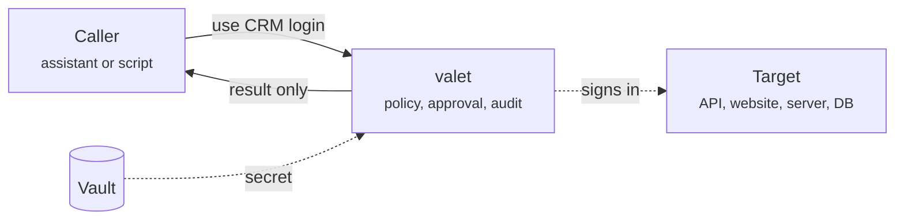

<h1>
  <picture>
    <source media="(prefers-color-scheme: dark)" srcset="assets/valet-dark.svg">
    
  </picture>
  valet
</h1>

valet lets a script or a coding assistant *use* a password, token or login from your Vaultwarden (or
Bitwarden) vault without ever holding it, the same way an SSH agent signs for you without handing out your
private key. It is a small local MCP server and command-line tool for Windows: one executable, no runtime
to install.



Solid arrows: what the caller sees. Dotted: the secret, which only travels vault → valet → target.

## How it works

1. The caller asks for an action by **credential name**: "GET this URL with `CRM API`", "run `hostname` on
   the build server".
2. valet looks the item up in one vault collection (`Agent`), checks that the target is one the item
   allows, and shows you an approval window if the item's policy asks for one.
3. valet does the sign-in itself: injects the token, answers the Windows challenge, types into the login
   form, opens the SSH, WinRM, SQL Server or Remote Desktop session.
4. The caller gets the result back. Anything that echoes the secret is replaced with
   `[REDACTED:CRM API]`, and one line goes into the audit log.

There are three ways in:

| Who | How | Secret ever in the caller? |
|---|---|---|
| Coding assistant | MCP tools: `http_request`, `browser_login`, `ssh_exec`, `win_exec`, `sql_query`, `rdp_open`, `check_credentials` | No |
| Script you wrote | `valet run -- <command>` with `valet://` references in the environment | In the script's memory only; its output is redacted |
| You, at the terminal | `valet rdp <item>`, `valet check` | No (Windows gets the RDP login directly) |

## Install

Windows 10 or 11 (valet's windows use the WebView2 runtime that ships with them).

1. Download `valet.exe` from the [latest release](https://github.com/The-Tech-Boi/valet/releases/latest)
   (or build it: `cargo build --release`, Rust stable). The exe is not code-signed, so check it against the
   release's `SHA256SUMS`: `Get-FileHash valet.exe`.
2. Install it. This copies `valet.exe` to `%LOCALAPPDATA%\Programs\valet` and adds that folder to your user
   PATH (no admin rights), so `valet` works in any new terminal. From the download folder:
   ```
   .\valet.exe install
   ```
   Run it again with a newer `valet.exe` to update; `valet uninstall` removes it.
3. The first install opens the setup window: your vault URL and your **personal** API key (web vault →
   Account settings → Security → Keys → View API key; the `client_id` starts with `user.`). valet keeps the
   login in `%LOCALAPPDATA%\valet`, protected with Windows DPAPI. `valet setup` changes it later.
4. In the vault, create a collection named `Agent` and put the items valet may use in it. Nothing outside
   that collection exists for valet.
5. Register the MCP server in your client: a stdio server whose command is the installed exe, no
   arguments.
   ```json
   {
     "mcpServers": {
       "valet": { "command": "C:\\Users\\<you>\\AppData\\Local\\Programs\\valet\\valet.exe" }
     }
   }
   ```
6. For `browser_login`, start the shared browser with `valet browser`. It launches Edge (or Chrome) with
   `--remote-debugging-port=9333` and its own profile in `%LOCALAPPDATA%\valet\browser-profile`. Point other
   browser automation at the same endpoint (for example Playwright MCP with
   `--cdp-endpoint http://127.0.0.1:9333`).

The first tool call starts a background agent, which opens an Unlock window for your master password and
then serves every MCP client until `valet lock` or `valet stop`. It reads the vault when it unlocks, so
after changing items run `valet lock`; the next call unlocks again with the current items.

Environment variables (no config files):

| Variable | Default |
|---|---|
| `VALET_COLLECTION` | `Agent` (collection name or id) |
| `VALET_CDP` | `http://127.0.0.1:9333` |
| `VALET_DIR` | `%LOCALAPPDATA%\valet` (login, audit log, browser profile) |

## Setting up a vault item

An item is an ordinary login (username, password, optional TOTP) in the `Agent` collection. Its URIs say
where it may be used, and the scheme of each URI says how:

| URI | Used by | Notes |
|---|---|---|
| `https://api.example.com` | `http_request`, `browser_login` | exact host; `https://*.example.com` for subdomains |
| `ssh://10.0.0.5` | `ssh_exec` | password SSH; the host key must already be in `~/.ssh/known_hosts` |
| `winrm://10.0.0.6` | `win_exec` | PowerShell over WinRM, Negotiate/NTLM, port 5985, message-encrypted (`winrms://` for 5986) |
| `mssql://10.0.0.7` | `sql_query` | `DOMAIN\user` signs in with Windows auth, otherwise a SQL login |
| `rdp://10.0.0.6` | `rdp_open` | opens Remote Desktop for you, already signed in |
| `10.0.0.8` (no scheme) | `check_credentials` | never signed in to; reports which server ports are open so you know which scheme to add |

Any URI may add a `:port`. One item can list several URIs: a Windows server login might carry `winrm://`,
`rdp://` and `mssql://` for the same host. A password is never sent to a host or protocol the item does not
list.

Custom fields change the defaults:

| Field | Values | Default |
|---|---|---|
| `broker_auth` | web only: `bearer`, `basic`, `header:<Name>`, `query:<param>`, `form`, `ntlm` | `bearer` for `http_request`, `form` for `browser_login` |
| `broker_approval` | `never`, `daily`, `always` | per tool, see below |
| `broker_allow_http` | `yes` to allow plain http to the item's hosts (trusted network or VPN only) | https only (http always allowed for localhost) |
| `broker_trust_cert` | `yes` to accept a self-signed certificate (https, SQL Server, `winrms://`) | certificate validated |
| `user_selector`, `pass_selector`, `submit_selector` | CSS selectors for odd login forms | heuristics |

`browser_login` works with `form` and `ntlm` items; `http_request` with everything but `form`. `ntlm` is
Windows sign-in (servers answering 401 with `Negotiate`/`NTLM`, such as on-premises IIS apps), username as
`DOMAIN\user`. In the browser valet answers the sign-in challenge over the DevTools protocol and the browser
keeps it for the session, so later tabs on that host stay signed in.

**Approval.** Defaults per tool: `http_request` and `rdp_open` never; `browser_login`, `ssh_exec`,
`win_exec`, `sql_query` and `run` daily; `check_credentials` always (once per batch). `broker_approval` on
the item overrides all of them. The approval window names the credential, operation, host and calling
program: **Allow today** (only meaningful for `daily`), **Allow once**, or **Deny** (the default button).
Concurrent calls for the same item share one prompt.

### Examples

**API token** (`GitLab API`): password = the token; URI `https://gitlab.example.com`; no custom fields
(bearer, no approval). A token sent in a custom header instead: `broker_auth` = `header:PRIVATE-TOKEN`.

**Basic auth** (`Router admin API`): username and password; URI `https://router.example.lan`;
`broker_auth` = `basic`, `broker_approval` = `always`.

**Windows sign-in app** (`Intranet CRM`): username `CORP\jdoe`, password; URI
`http://crm.corp.lan:5555/Org`; `broker_auth` = `ntlm`, `broker_allow_http` = `yes` (only if it really is
plain http on a trusted network). Works for both the web UI and its REST API.

**Web login with TOTP** (`Vendor portal`): username, password, authenticator key (TOTP) set on the item;
URIs `https://portal.vendor.com` and `https://login.vendor.com` (the login redirect host must be listed
too); no custom fields (form, daily approval). If the form is unusual, add for example
`user_selector` = `#login-email`.

**Remote Desktop** (`Jump host`): username `CORP\jdoe` (or `.\admin` for a local account), password; URI
`rdp://jump.corp.lan`. The vault's Launch button cannot open it; call `rdp_open` or run
`valet rdp "Jump host"`.

## MCP tools

- `list_credentials()`: names, ids, allowed hosts, usable tools with auth type and approval policy, TOTP yes/no.
- `http_request(credential, method, url, headers, body, json, timeout)`: injects auth; refuses hosts not on
  the item; does not follow redirects; returns status, selected headers and the body (truncated at 20,000
  characters).
- `browser_login(credential, url)`: reuses a tab on an allowed host or opens the URL; fills username,
  password and TOTP; returns status, URL and title only. It re-checks the page host before typing anything.
- `ssh_exec(credential, command, host, timeout)`: returns exit code, stdout, stderr. (Key-based SSH: use an
  SSH agent.)
- `win_exec(credential, command, host, timeout)`: PowerShell over WinRM; returns exit code, stdout, stderr.
- `sql_query(credential, query, database, host, max_rows)`: T-SQL, autocommit.
- `rdp_open(credential, host)`: stores the login as a Windows domain credential for `TERMSRV/<host>` (only
  LSA can read its password back; dropped at sign-out) and starts `mstsc`. Nobody types the password.
- `check_credentials(credentials)`: one approval, then tries every item's sign-in on every URI and reports
  ok / failed / skipped.

## Scripts: `valet run`

Say you write `sync_contacts.py`, which signs in to SQL Server and an API. The usual shortcut is to paste
the password into the file. With valet, the file reads it from the environment:

```python
# Before: password in the file
conn = pyodbc.connect("SERVER=sql01;UID=sync;PWD=Summer2026!")

# After: read it from the environment
conn = pyodbc.connect(f"SERVER=sql01;UID=sync;PWD={os.environ['SQL_PASS']}")
```

Then say where `SQL_PASS` comes from, either on the command line:

```
valet run -e SQL_PASS=valet://SQL sync/password -- python sync_contacts.py
```

or in a `.env` file that is safe to commit, because it holds references and no secrets:

```
# .env
SQL_PASS=valet://SQL sync/password
API_TOKEN=valet://Contacts API/password
API_URL=https://contacts.example.com     # plain values pass through unchanged
```

```
valet run --env-file .env -- python sync_contacts.py
```

What happens then:

1. valet finds every variable whose value starts with `valet://`. The part before the last `/` is the item
   name, the part after it the field: `password`, `username`, `totp` (the current code), `uri`, or any
   custom field.
2. It asks your approval once per item (default once a day; set `broker_approval` to `never` for unattended
   jobs, `always` for sensitive ones). The window shows the item and the exact command line.
3. It starts the command with the real values in its environment, and removes `BW_SESSION` so the script
   gets its own secrets and not the key to the whole vault.
4. Every line the script prints goes through the redactor, so a stray `print(password)`, a stack trace or a
   debug log shows `[REDACTED:SQL sync]`. The exit code is passed on.
5. The audit log gets a line: time, item names, command, ok or refused.

This works for any language, because every language reads environment variables (`$env:SQL_PASS`,
`process.env.API_TOKEN`, `$API_TOKEN`). Still, when a coding assistant runs the job and the script only
calls an API or runs commands on a server, let it use `http_request`, `ssh_exec` or `win_exec` directly:
then no process outside valet ever holds the secret. `valet run` is for code that really needs the value
itself, such as a database driver.

## After an import: find the wrong passwords

Bulk imports from old notes are never perfect. Instead of retyping everything, run

```
valet check
```

It asks once, tries every item's sign-in and prints `ok`, `failed` or `skipped` per URI. Fix only the
failed ones in the vault, run `valet lock`, then check again.

## Command line

```
valet                   MCP server on stdio (what MCP clients run)
valet install           copy to %LOCALAPPDATA%\Programs\valet, add to PATH, then setup
valet uninstall         undo install (your login in %LOCALAPPDATA%\valet stays)
valet setup             connect to the vault: URL and personal API key
valet unlock | lock     unlock (asks the master password) or lock the agent
valet status            locked/unlocked, item count
valet stop              stop the background agent
valet run ... -- CMD    see above
valet rdp ITEM [HOST]   Remote Desktop, signed in
valet check [ITEM...]   ok/failed per item and URI
valet browser           Edge/Chrome with the DevTools port browser_login uses
```

Every call is appended to `%LOCALAPPDATA%\valet\audit.jsonl` (time, tool, credential, method, host and
path without query string, result). No secrets are written there.

## What it does and does not protect

| Protected | Not protected |
|---|---|
| Secrets stay out of the assistant's context, transcripts and logs | valet runs as your Windows user: a hostile program running as you can read what valet can |
| A credential only goes to the hosts and protocols listed on its item | A script started with `valet run` holds the real value and could write it somewhere other than its output |
| Only the `Agent` collection is visible; the rest of the vault does not exist for valet | The shared browser keeps the session cookie after `browser_login`, which is the point; a hostile caller could also read a field valet just filled |
| Approval windows and an audit trail of every use | |
| RDP passwords are stored as Windows domain credentials, which ordinary programs cannot read back | |

In short: valet keeps honest automation from ever seeing secrets, and makes every use visible. It is not a
sandbox against malicious code running as your own user. For that, run it as a separate account or on
another machine.

## Development

```
cargo test
cargo clippy --all-targets
```

Tests are offline (fake vault, local test servers). The browser tests drive a real Edge or Chrome.
The icon is drawn in `assets/valet.svg` (and `valet-small.svg` for 16–24 px); `py -3 assets/make_icon.py`
rebuilds `assets/valet.ico`, which `build.rs` embeds in the exe.

## Licence

MIT, see [LICENSE](LICENSE).
